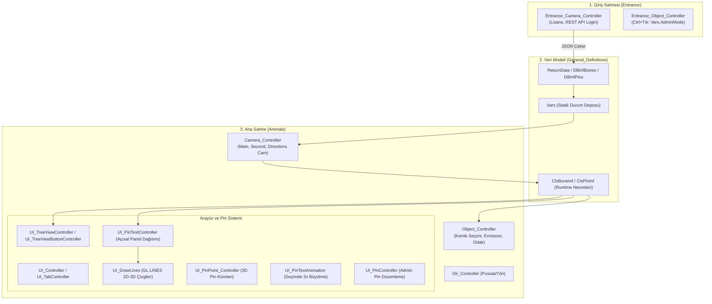

# VetOs 3D Enhanced: Faz 0 Mimari Analiz ve Keşif Raporu (ANALYSIS.md)

Bu rapor, ZCortex tarafından geliştirilen **3D Veterinary Osteology (VetOs)** uygulamasının decompile edilmiş C# kodları (`Assembly-CSharp.dll`) ve Android APK paketi (`ZCortex.VetOs.apk`) üzerinden gerçekleştirilen tersine mühendislik ve mimari analiz sonuçlarını içerir.

---

## 1. Genel Mimari ve Sınıf Yapısı

Uygulama, Unity 2022.3.11f1 Mono altyapısı üzerine inşa edilmiştir. İki ana sahneden oluşur:
1. **Giriş Sahnesi (`Entrance`)**: Kullanıcı doğrulama, lisans kontrolü, hayvan seçimi ve API senkronizasyonu.
2. **Ana Sahne (`Animals`)**: 3D anatomi görüntüleyici, kemik hiyerarşisi, pin/etiket sistemi ve karşılaştırmalı görünüm.



### 1.1 Giriş Sahnesi (`Entrance`)
- **`Entrance_Camera_Controller`**:
  - Uygulama ilk açıldığında `LoadLicence()` metodunu çalıştırır.
  - `Application.persistentDataPath + "/LicenceInf.dat"` dosyasını `BinaryFormatter` ile deserialize ederek istemci kimliğini (`VetosClientID` GUID) okur veya ilk çalıştırmada yeni bir GUID üreterek bu dosyaya yazar.
  - REST API (`https://apivetos.zcortex.com.tr/v1/Login`) uç noktasına `LoginRequest` (demo kontrolü `CheckDemo` veya kullanıcı kontrolü `CheckLicence`) gönderir.
  - API'den dönen `ReturnData` nesnesi içindeki kemik ve pin listelerini `Vars.RetData` içine atar.
- **`Entrance_Object_Controller`**:
  - Giriş sahnesindeki 3D hayvan modellerinin (At, Sığır, Koyun, Köpek) tıklama etkileşimini yönetir.
  - **Gizli Yönetici Modu (Admin Mode):** `OnMouseUpAsButton()` içerisinde `Input.GetAxis("Ctrl")` kontrolü yapılır. Kullanıcı `Ctrl` tuşuna basılı tutarak hayvana tıkladığında `Vars.AdminMode = true` olarak atanır; aksi halde `false` kalır. Admin modunda pin ekleme/düzenleme kanvası (`PINControlCanvas`) açılır.

### 1.2 Ana Sahne (`Animals`)
- **`Camera_Controller`**:
  - Üçlü kamera sistemini koordine eder:
    1. **`Main Camera`**: Aktif incelenen hayvanın ve seçili kemiğin ana 3D görünümünü sunar.
    2. **`Second Camera`**: Karşılaştırma modunda eşleştirilen diğer hayvanın kemiğini paralel olarak gösterir (`SecondCameraFocusPoint` ve `SecondCameraPosition` üzerinden hareket eder).
    3. **`Directions Camera` (`DirectionCamera`)**: Sağ üst/sol kısımdaki yön kılavuzunu (anatomik oryantasyon eksenlerini) yönetir.
  - `TakeAndStoreBoneInf(string BoneStartCode, ref ClsBoneInf[] BoneArr, bool AnimalInScene)`: API'den gelen `Vars.RetData.ListOfBones` verisini dolaşarak hayvan türüne ait hiyerarşik kemik ağacını (`ClsBoneInf[]`) oluşturur.
  - `DetermineOtherInf()`: Kemiklerin hiyerarşik ilişkilerini, ebeveyn-çocuk bağlarını ve eksenel sınırlarını (bounding box) hesaplar.
  - `DeterminePinInf()`: `Vars.RetData.ListOfPins` listesinden ilgili hayvanın kemiklerine ait pin noktalarını (`ClsPinInf`) yükler.
- **`Object_Controller`**:
  - Sahnedeki her kemik mesh'ine bağlıdır. Tıklama, çoklu seçim ve çift tıklama eylemlerini dinler.
  - **Parlatma (Highlighting):** Seçilen kemiğin materyalindeki `_EmissionColor` parametresini değiştirerek parlatır; seçim kalktığında orijinal rengine döndürür. Eşleşen karşılaştırma kemiği varsa (`ComparedBone`), onun da parlamasını senkronize eder.
  - **Çift Tık Odaklanma:** Sol çift tık (`DoubleClickType == 0`) hiyerarşide bir alt seviyeye odaklanarak alt kemikleri görüntüler (`DisplaySelectedBones`); sağ çift tık (`DoubleClickType == 1`) ise bir üst seviyeye geri döner.
- **`Dir_Controller`**:
  - Anatomik yön göstergesini (Cranial, Caudal, Dorsal, Ventral vb.) günceller ve kameranın baktığı açıya göre yön metinlerini hizalar.

### 1.3 Arayüz ve Pin Sistemi
- **`UI_Controller` & `UI_TabController`**:
  - Sol ve sağ arayüz panellerini, karşılaştırma ekranı geçişlerini ve görünüm modlarını yönetir.
- **`UI_TreeViewController` & `UI_TreeViewButtonController`**:
  - Hiyerarşik anatomik ağaç listesini (TreeView) oluşturur. Arama kutusuna (`InputFieldTextBox`) girilen metne göre kemikleri filtreler.
- **`UI_PinTextController` (Akıllı Açısal Panel Dağıtımı)**:
  - Kemik üzerindeki pin etiketlerini üç ayrı ekrana dağıtır:
    - `PINTextPanel_Left_Top` (Sol Üst)
    - `PINTextPanel_Left_Bottom` (Sol Alt)
    - `PINTextPanel_Right_Bottom` (Sağ Alt)
  - Etiketlerin birbirinin üzerine binmesini engellemek için, pin noktalarının 2D ekran izdüşümlerinin panel merkezine göre açılarını (`Vector2.Angle`) hesaplar ve hiyerarşi sırasını (`SetSiblingIndex`) bu açısal sıralamaya göre düzenler.
- **`UI_DrawLines` (2D-3D Dinamik Çizgi Çizimi)**:
  - `OnRenderObject()` yaşam döngüsünde düşük seviyeli Unity GL kütüphanesini (`GL.Begin(GL.LINES)`) ve `Hidden/Internal-Colored` gölgelendiricisini (shader) kullanır.
  - 2D UI etiketinin ekran konumu ile 3D uzaydaki pin küresinin (`clsPinInf.PinPoint`) viewport koordinatı arasında dinamik kılavuz çizgileri çizer.
  - Aktif seçili pin için **yeşil** (`Color.green`), diğer pinler için **sarı** (`Color.yellow`) renk kullanır.
- **`UI_PinPoint_Controller`**:
  - 3D sahnedeki pin kürelerini yönetir. Fare üzerine geldiğinde rengini yeşile (`new Color32(100, 200, 0, 255)`) çevirir ve anlık tooltip metnini ekrana basar.
- **`UI_PinTextAnimation`**:
  - Pin etiketine tıklandığında `ThisPin.Activate()` çağırarak 3D pin küresini ve etiketini 3 kat (`Multiplier = 3f`) büyütür; seçim kalktığında 1/3 oranında küçülterek orijinal boyutuna döndürür.
- **`UI_PinController`**:
  - Sadece `Vars.AdminMode == true` olduğunda aktifleşen, yeni pin koordinatlarını 3D eksende (`TransX`, `TransY`, `TransZ`) hassas ayarlamaya ve kaydetmeye yarayan yönetim arayüzüdür.

### 1.4 Veri Modelleri (`General_Definitions.cs`)
- **`Vars`**: Uygulamanın tüm çalışma zamanı durumunu (seçili dil, aktif hayvan, karşılaştırma durumları, admin modu, aktif kemik/pin) tutan merkezi statik sınıftır.
- **`ClsBoneInf`**: Çalışma zamanında sahnede yaşayan kemik nesnesidir (`GameObject`, `Material`, hiyerarşik bağlar, çocuk ve ebeveyn kemikler, pin dizisi).
- **`ClsPinInf`**: Çalışma zamanında 3D pin noktasını ve 2D etiket referanslarını (`LeftPinText`, `RightPinText`, `PinPoint`) temsil eder.
- **`DBInfBones`**: Veritabanı/API'den gelen kemik veri şablonudur.
- **`DBInfPins`**: Veritabanı/API'den gelen pin veri şablonudur.
- **`ReturnData`**: API giriş yanıtını, sürüm bilgisini, lisans durumunu ve kemik/pin listelerini taşıyan DTO modelidir.

---

## 2. Kemik ve Pin İsimlendirmesi Sorunu

Decompile edilen veri yapıları incelendiğinde, Türkçe dil desteğinin aslında altyapıda hiç var olmadığı tespit edilmiştir:

1. **Veri Modelinde Türkçe Alan Bulunmaması:**
   - `DBInfBones` sınıfında yalnızca şu alanlar yer almaktadır:
     ```csharp
     public string LATINE_NAME;
     public string ENG_NAME;
     public string LATINE_DESC;
     public string ENG_DESC;
     ```
   - `DBInfPins` sınıfında da benzer şekilde yalnızca iki dil alanı mevcuttur:
     ```csharp
     public string DESC_LATIN;
     public string DESC_ENG;
     ```
   - Her iki modelde de Türkçe ad (`TURKISH_NAME`, `TURKISH_DESC`) için tanımlanmış hiçbir alan yoktur.

2. **Arayüzde Türkçe Seçildiğinde Latince Gösterilmesi:**
   - `UI_TreeViewController.cs` içerisindeki dil dallanması:
     ```csharp
     if (Vars.Language == Languages.Turkish)
     {
         TextBoxBoneShortDesc.text = CurBone.LatineName;
         TextBoxBoneLongDesc.text = CurBone.LatineLongDesc;
     }
     else if (Vars.Language == Languages.English)
     {
         TextBoxBoneShortDesc.text = CurBone.EngName;
         TextBoxBoneLongDesc.text = CurBone.EngLongDesc;
     }
     ```
   - Aynı durum TreeView butonlarında da görülmektedir: `Vars.Language == Languages.Turkish` durumunda buton metnine doğrudan `clsBoneInf.LatineName` atanmaktadır.
   - Pin noktalarında fare üzerine gelindiğinde (`UI_PinPoint_Controller.cs`) `CurrentPinToolTipText = CurPin.Desc_Latin;` atanarak doğrudan Latince basılmaktadır.
3. **Sonuç ve Çözüm Yaklaşımı:**
   - Kullanıcı uygulamada Türkçeyi seçtiğinde karşısına yalnızca Latince terimler çıkmaktadır.
   - Faz 2 kapsamında harici bir yerel sözlük (`assets\terms.json`) oluşturulacak; BepInEx ve Harmony yamaları aracılığıyla `CurBone.LatineName` çağrıları bu sözlükten taranarak anatomik Türkçe karşılıkları (Nomina Anatomica Veterinaria standartlarına uygun) arayüze enjekte edilecektir.

---

## 3. Karşılaştırmalı Anatomi Kısıtlaması

Uygulamanın karşılaştırma modunda hayvan türleri arasındaki eşleşme serbest bir matris şeklinde değil, katı bir biçimde kod içine gömülmüştür:

- **`Vars.cs` İçindeki Sabit Eşleme Dizileri:**
  ```csharp
  public static string[] GroupNames = new string[4] { 
      "Sheep_Group", "Beef_Group", "Horse_Group", "Dog_Group" 
  };

  public static string[] CompGroupNames = new string[4] { 
      "Dog_Group", "Horse_Group", "Beef_Group", "Sheep_Group" 
  };

  public static string[] GroupCodes = new string[4] { "A", "B", "C", "D" };
  public static string[] CompGroupCodes = new string[4] { "D", "C", "B", "A" };
  ```

- **Mevcut Durum:**
  - İndeks 0 (Koyun - A) doğrudan İndeks 3 (Köpek - D) ile eşleştirilmiştir.
  - İndeks 1 (Sığır - B) doğrudan İndeks 2 (At - C) ile eşleştirilmiştir.
  - İndeks 2 (At - C) doğrudan İndeks 1 (Sığır - B) ile eşleştirilmiştir.
  - İndeks 3 (Köpek - D) doğrudan İndeks 0 (Koyun - A) ile eşleştirilmiştir.

- **Sorun:**
  - Kullanıcı At ile Köpeği ya da Sığır ile Koyunu karşılaştıramaz. Sistem yalnızca iki sabit çifti (Koyun ↔ Köpek ve Sığır ↔ At) desteklemektedir.
  - Eşleşme `GroupCodes` ve `CompGroupCodes` üzerinden kemik kodlarının baş harfleri değiştirilerek (`A...` -> `D...` veya `C...` -> `B...`) yapılmaktadır.
- **Faz 3 Çözüm Planı:**
  - `CompGroupNames` ve `CompGroupCodes` indeks mantığı esnetilerek kullanıcının dilediği iki hayvan türünü seçip karşılaştırabileceği dinamik bir karşılaştırma paneli ve kod eşleme mekanizması kurgulanacaktır.

---

## 4. Uzak Sunucu (REST API) Bağımlılığı

Uygulama, kemik ve pin anatomik verilerini yerel kurulum dosyalarından (`StreamingAssets` veya `AssetBundle`) okumamaktadır:

- **Her Açılışta API Çağrısı:**
  - `Entrance_Camera_Controller.cs` içerisinde `https://apivetos.zcortex.com.tr/v1/Login` adresine HTTP POST isteği gönderilir.
  - JSON gövdesinde istemci ID'si (`LicenceInf.dat` içindeki GUID) iletilir.
  - API'den gelen cevap `Vars.RetData` içine doldurulur.
  - Eğer sunucuya erişilemezse veya sunucu hata dönerse (`!Vars.RetData.IsBoneInfTaken || !Vars.RetData.IsPinInfTaken`), uygulama `ShowErrorMessage()` çağırır ve ana sahneye geçişe izin vermez.
- **Riskler ve İhtiyaç:**
  - ZCortex sunucularının kapanması, internet kesintisi veya DNS sorunları durumunda uygulama tamamen çalışamaz hale gelir.
  - **Çözüm:** Çevrimdışı JSON önbellekleme (offline cache) sistemi geliştirilmelidir. Başarılı bir oturum açma sonrasında `Vars.RetData` yerel bir `cache/bones_pins_cache.json` dosyasına yazılmalı; internet yoksa veya API yanıt vermiyorsa BepInEx yamasını devreye sokarak bu yerel önbellek doğrudan `Vars.RetData` içerisine yüklenmelidir.

---

## 5. Android APK ("Telefonunuzla Uyumlu Değil") Hatasının Teknik Analizi

Kullanıcının Honor Pad / modern Android cihazına APK yüklemeye çalıştığında karşılaştığı **"Bu uygulama cihazınızla uyumlu değil"** hatası detaylı şekilde analiz edilmiştir.

### 5.1 APK İnceleme Verileri
- **Dosya Konumu:** `C:\Users\user\Downloads\ZCortex.VetOs.apk`
- **Dosya Boyutu:** 219.33 MB
- **Paket Adı:** `com.ZCortex.VetOs`
- **Sürüm:** v1.0.1 (Sürüm Kodu: 2)
- **SDK Düzeyleri:** `minSdkVersion: 22` (Android 5.1), `targetSdkVersion: 32` (Android 12L)
- **Derleme Motoru:** `Unity 2022.3.11f1;Mono;Release`

### 5.2 Hatanın Kök Nedeni
- APK arşivi açıldığında `lib/` klasörü altında **yalnızca 32-bit `armeabi-v7a` kütüphanesinin** (`libmono.so`, `libunity.so` vb.) bulunduğu, **64-bit `arm64-v8a` kütüphanelerinin hiç bulunmadığı** görülmüştür.
- Yeni nesil Honor tabletler, Google Pixel cihazlar ve Qualcomm Snapdragon / MediaTek Dimensity işlemcili modern cihazlar (Android 13/14+), 32-bit komut kümesi desteğini donanımsal ve işletim sistemi düzeyinde tamamen kaldırmıştır (64-bit-only).
- Android işletim sistemi 32-bit ikili dosyaları çalıştırmayı reddettiği için paket yöneticisi kurulum sırasında `INSTALL_FAILED_CPU_ABI_INCOMPATIBLE` hatası fırlatmakta ve kullanıcıya "Cihazınızla uyumlu değil" uyarısı vermektedir.

### 5.3 Çözüm Stratejisi
1. **AssetRipper ile Projenin Çıkarılması:** APK veya PC veri dosyalarından modeller, materyaller, sahneler ve UI öğeleri eksiksiz bir Unity projesi olarak dışa aktarılır.
2. **Unity Editor 2022.3.11f1 ile Açılması:** Proje orijinal sürümü olan 2022.3.11f1 ile açılır.
3. **Derleme Ayarlarının Güncellenmesi:**
   - Scripting Backend: `Mono` yerine `IL2CPP` seçilir (Unity'de ARM64 derlemek için IL2CPP zorunludur).
   - Target Architectures: `ARM64` (`arm64-v8a`) aktif edilir (`ARMv7` isteğe bağlı bırakılabilir).
   - Target API Level: Android 13/14 uyumu için `API Level 33` veya `34` olarak ayarlanır.
4. **Yeniden Derleme:** 64-bit uyumlu yeni APK (`arm64-v8a`) üretilir. Bu sayede tüm modern tablet ve telefonlarda sorunsuz kurulum sağlanır.

---

## 6. Özet ve Yol Haritası

| Faz | Kapsam | Durum | Temel Çıktılar |
|---|---|---|---|
| **Faz 0** | Keşif ve Mimari Analiz | **Tamamlandı** | Kaynak kod analizi, mimari harita, APK uyumluluk tespiti, `ANALYSIS.md`. |
| **Faz 1** | Modlama Altyapısı | Sıradaki | BepInEx x64 entegrasyonu, UnityExplorer, test Harmony eklentisi, `build.ps1`. |
| **Faz 2** | Türkçe Sözlük ve İsimlendirme | Planlandı | `terms.json` sözlüğü, `UI_TreeViewController` ve Pin etiketleri için Harmony yaması. |
| **Faz 3** | Karşılaştırmalı Anatomi | Planlandı | Dinamik hayvan eşleme, serbest karşılaştırma matrisi, API offline cache. |
| **Mobil** | Android 64-Bit Dönüşümü | Planlandı | AssetRipper dışa aktarımı, Unity 2022.3.11f1 IL2CPP ARM64 derlemesi. |
